<div align="center">

# 🧮 AFSIN – MATH WHIZ

### A Web-Based Mathematical Challenge Game built with Java Servlet, JSP & JDBC

**Practical Lab Assignment · Java Web Application Development · 10 Marks**

[](https://www.oracle.com/java/)
[](https://tomcat.apache.org/)
[](#04-system-architecture)
[](https://www.mysql.com/)
[](#11-testing)
[](LICENSE)

</div>

---

## 📑 Table of Contents

1. [Project Title & Description](#01-project-title--description)
2. [Project Objectives](#02-project-objectives)
3. [Features at a Glance](#03-features-at-a-glance)
4. [System Architecture](#04-system-architecture)
5. [Game Rules & Scoring System](#05-game-rules--scoring-system)
6. [How Each Question Is Evaluated](#06-how-each-question-is-evaluated)
7. [Database Design](#07-database-design)
8. [Technologies & Software Requirements](#08-technologies--software-requirements)
9. [Project Structure](#09-project-structure)
10. [Steps to Run the Application](#10-steps-to-run-the-application)
11. [Testing](#11-testing)
12. [Application Screenshots](#12-application-screenshots)
13. [Troubleshooting](#13-troubleshooting)
14. [Learning Outcomes & Future Improvements](#14-learning-outcomes--future-improvements)
15. [GitHub Submission Checklist](#15-github-submission-checklist)

---

## 01. Project Title & Description

**AFSIN – MATH WHIZ** is a server-side web application developed in Java using standard **Java Servlets**, **JavaServer Pages (JSP)** and **JDBC (Java Database Connectivity)**. The player enters their own test numbers and the server calculates the answers for three core quantitative areas:

| # | Area | What the player does |
|---|------|----------------------|
| 1 | **Prime Number Validation** | Checks whether a given integer is prime |
| 2 | **Modulus Arithmetic** | Calculates a division remainder, with zero-divisor validation |
| 3 | **Trigonometric Functions** | Calculates Sine, Cosine or Tangent from a degree input converted to radians |

All answers are evaluated **dynamically by reusable Java methods** (`MathService.java`), never by static or pre-recorded values. Player scores, the difficulty level (`NORMAL`) and timestamps are stored in a MySQL database (`math_whiz_db`), and a live **Top 10 Leaderboard** ranks players by score and completion time.

---

## 02. Project Objectives

- Implement **reusable, modular** Java methods for mathematical computations.
- Master **server-side request/response processing** using `HttpServlet` (`GameServlet`).
- Design and execute **secure SQL operations** using JDBC and `PreparedStatement`.
- Build an interactive, user-friendly **multi-screen interface** with JSP and CSS.
- Manage **persistent state and leaderboard ranking** with proper sorting criteria.

---

## 03. Features at a Glance

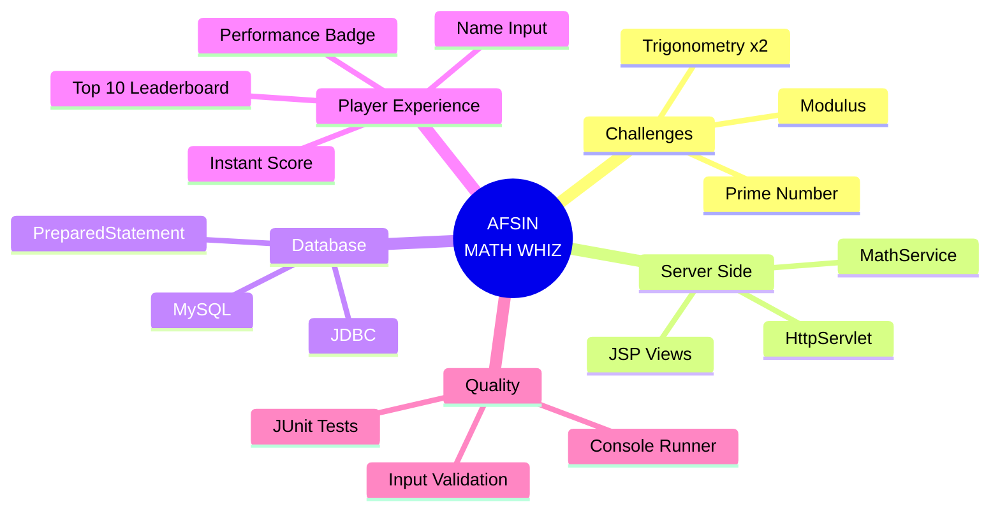

---

## 04. System Architecture

The application follows a clean **MVC-style, layered design**. JSP pages are the *View*, `GameServlet` is the *Controller*, and `MathService`, `GameScore`, `ScoreDAO` and `DBConnection` form the *Model / data layer*.

### 4.1 Layered Architecture

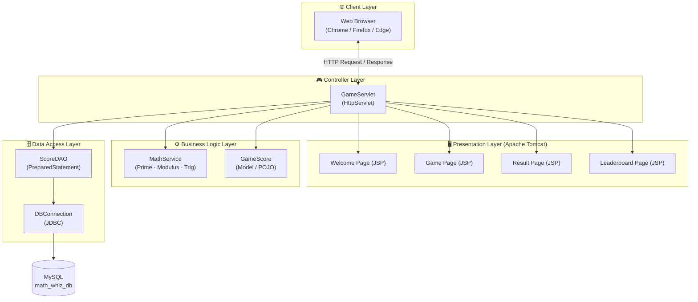

### 4.2 End-to-End Request Flow (Sequence Diagram)

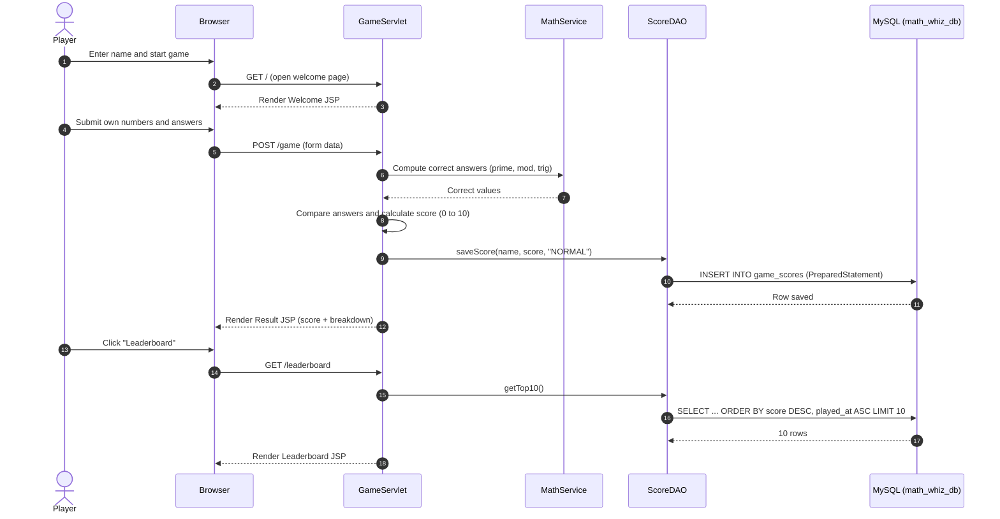

### 4.3 Screen Navigation (State Diagram)

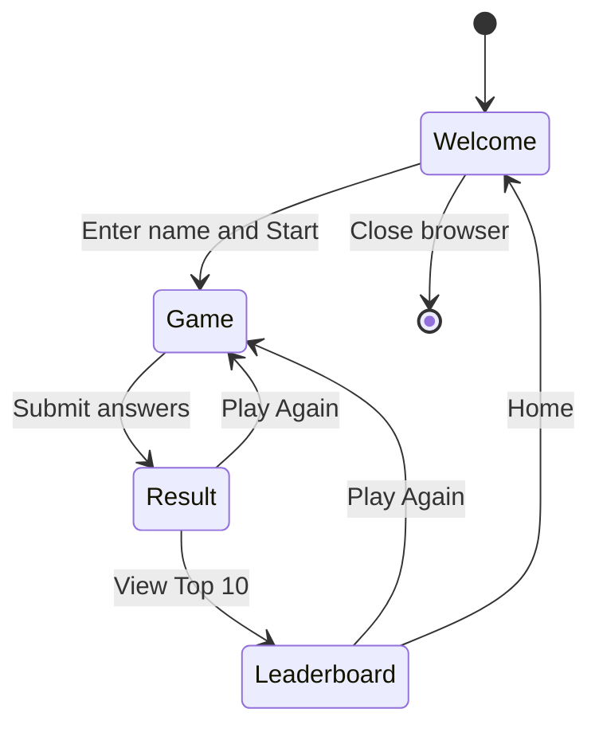

### 4.4 Class Diagram (simplified)

> Method names are simplified for illustration; see the source files for exact signatures.

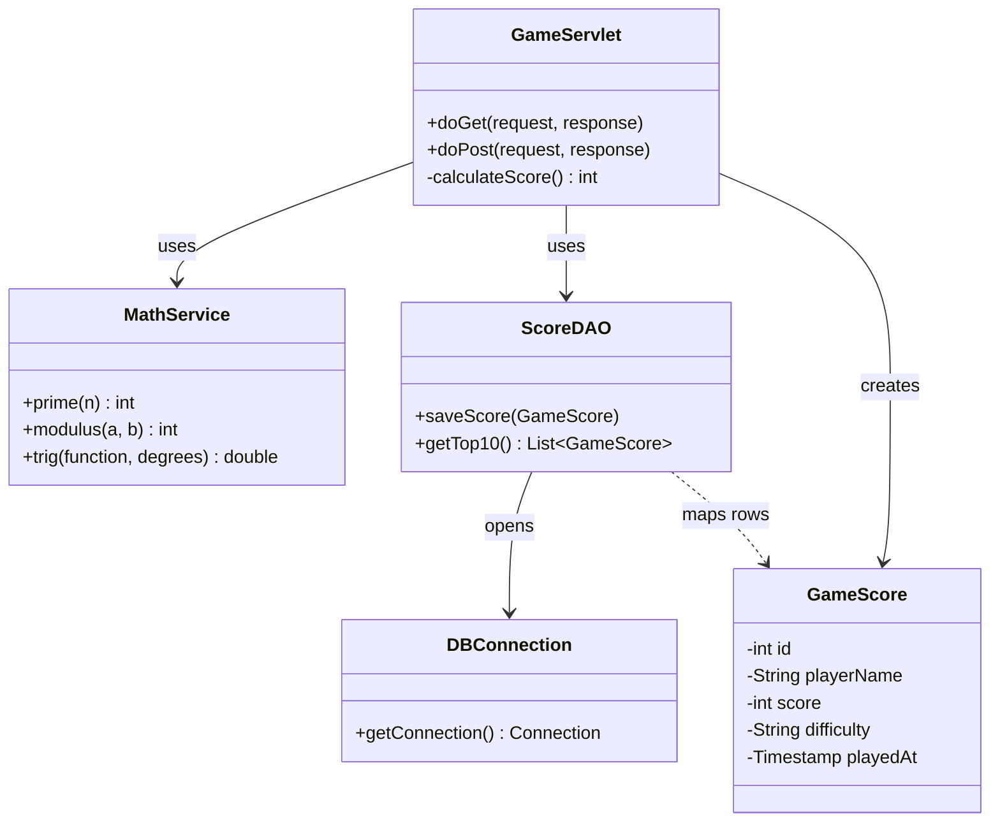

---

## 05. Game Rules & Scoring System

The game presents **4 challenges** worth a maximum of **10 Marks**:

| Question # | Mathematical Area | Evaluation Criteria | Marks |
|---|---|---|---|
| **Q1** | **Prime Number** | Return `1` if the number is prime, otherwise `0`. Numbers less than 2 are not prime. | **2** |
| **Q2** | **Modulus Operation** | Calculate integer remainder `a % b`. Divisor `b` cannot be 0 (handled via `ArithmeticException`). | **2** |
| **Q3** | **Trigonometric Value 1** | Calculate `sin(θ)`, `cos(θ)` or `tan(θ)` using `Math.toRadians(deg)`. Tolerance ±0.05. | **3** |
| **Q4** | **Trigonometric Value 2** | Calculate `sin(θ)`, `cos(θ)` or `tan(θ)` using `Math.toRadians(deg)`. Tolerance ±0.05. | **3** |
| **TOTAL** | — | — | **10** |

### Mark Distribution

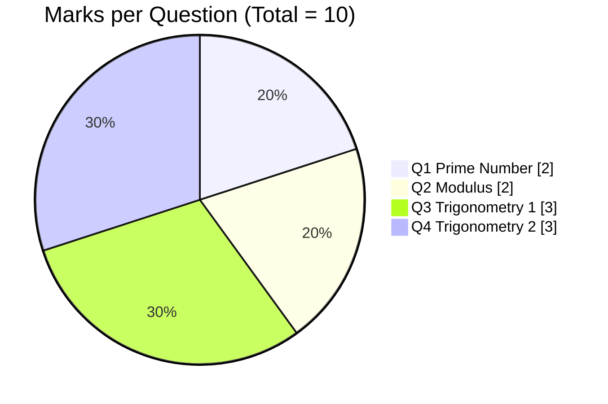

### Scoring Algorithm (`GameServlet.java`)

```java
int totalScore = 0;
if (primeCorrect) totalScore += 2;
if (modCorrect)   totalScore += 2;
if (trig1Correct) totalScore += 3;
if (trig2Correct) totalScore += 3;
// Maximum Possible: 10 Marks
```

### Difficulty Level

- **NORMAL**: recorded in the database for every game, as required by the specification.

---

## 06. How Each Question Is Evaluated

### 6.1 Prime Number (Q1)

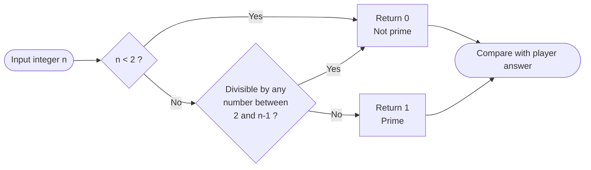

### 6.2 Modulus (Q2)

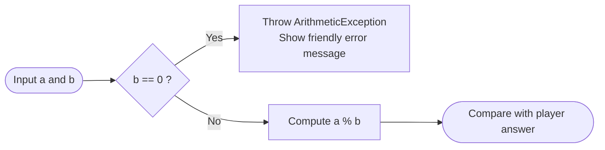

### 6.3 Trigonometry (Q3 and Q4)

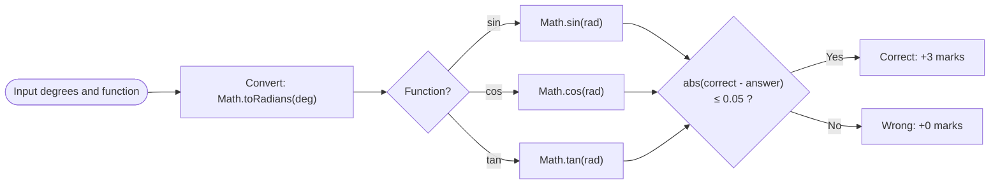

### 6.4 Sample Test Values

| Question | Input | Expected result |
|---|---|---|
| Prime | `17` | `1` (prime) |
| Prime | `18` | `0` (not prime) |
| Prime | `1` | `0` (less than 2) |
| Modulus | `17 % 5` | `2` |
| Modulus | `10 % 0` | Error: division by zero handled |
| Trig | `sin(30°)` | `0.5` |
| Trig | `cos(60°)` | `0.5` |
| Trig | `tan(45°)` | `1.0` |

---

## 07. Database Design

### Database Details

| Property | Value |
|---|---|
| **Database Name** | `math_whiz_db` |
| **Table Name** | `game_scores` |
| **Default Port** | `3306` |
| **Default Username** | `root` |
| **Default Password** | `""` (blank, standard for XAMPP) |

### Entity-Relationship Diagram

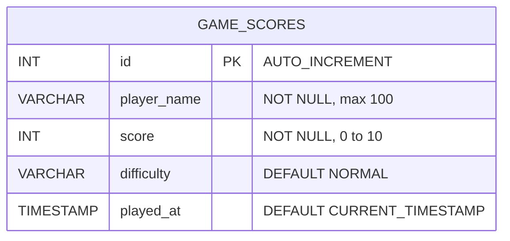

### Leaderboard Ranking Logic

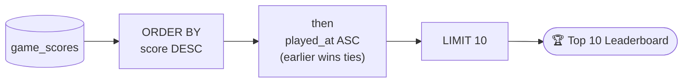

### Database Creation SQL (`database/math_whiz_db.sql`)

```sql
-- 1. Create Database
CREATE DATABASE IF NOT EXISTS math_whiz_db
    CHARACTER SET utf8mb4
    COLLATE utf8mb4_unicode_ci;

USE math_whiz_db;

-- 2. Create game_scores Table
CREATE TABLE IF NOT EXISTS game_scores (
    id INT AUTO_INCREMENT PRIMARY KEY,
    player_name VARCHAR(100) NOT NULL,
    score INT NOT NULL,
    difficulty VARCHAR(20) NOT NULL DEFAULT 'NORMAL',
    played_at TIMESTAMP DEFAULT CURRENT_TIMESTAMP
) ENGINE=InnoDB DEFAULT CHARSET=utf8mb4;

-- 3. Top 10 Leaderboard Query (Task 08)
SELECT id, player_name, score, difficulty, played_at
FROM game_scores
ORDER BY score DESC, played_at ASC
LIMIT 10;
```

> 🔒 **Security note:** all database operations use `PreparedStatement`, which protects the application against **SQL injection**.

---

## 08. Technologies & Software Requirements

### Technologies Used

| Layer | Technology |
|---|---|
| **Language** | Java (JDK 17 / 21+) |
| **Server-Side Engine** | Java Servlet 4.0 / 3.1 (`javax.servlet`) |
| **View Presentation** | JavaServer Pages (JSP) + Custom Responsive CSS |
| **Database** | MySQL Server 8.0+ / MariaDB (XAMPP compatible) |
| **Database Connectivity** | JDBC (`mysql-connector-j-8.4.0.jar`) with `PreparedStatement` |
| **Testing** | JUnit 4 and Standalone Console Verification Runner (`MathWhizTester`) |
| **Build & Packaging** | Apache Maven / Standard WAR archive |

### Software Requirements

- **Java Development Kit (JDK):** version 17 or higher.
- **Web / Application Server:** Apache Tomcat 8.5, 9.0 or 10.1 (or standalone runner).
- **Database Server:** MySQL Server (e.g., via XAMPP Control Panel).
- **Web Browser:** Google Chrome, Mozilla Firefox or Microsoft Edge.

> ⚠️ **Compatibility note:** the code uses the `javax.servlet` namespace, which works on **Tomcat 8.5 and 9.0**. Tomcat 10+ switched to `jakarta.servlet`, so on Tomcat 10.1 the imports must be migrated to `jakarta.servlet.*` (or use the bundled 1-click launcher, which runs a compatible server).

### Deployment View

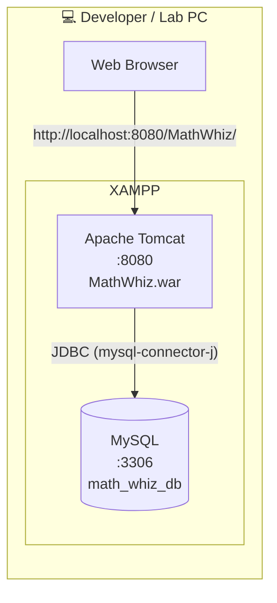

---

## 09. Project Structure

```text
MathWhiz/
├── src/
│   ├── controller/    GameServlet.java
│   ├── model/         GameScore.java
│   ├── service/       MathService.java
│   ├── dao/           ScoreDAO.java
│   ├── util/          DBConnection.java, ConsoleGame.java
│   └── test/          MathWhizTester.java, JUnit tests
├── webapp/
│   ├── *.jsp          Welcome, Game, Result, Leaderboard views
│   ├── css/           Responsive stylesheet
│   └── WEB-INF/       web.xml, lib/ (JDBC driver)
├── database/
│   └── math_whiz_db.sql
├── screenshots/       home.png, game.png, result.png, leaderboard.png
├── target/            MathWhiz.war (build output)
├── Play_MathWhiz.bat  1-click launcher
├── pom.xml
└── README.md
```

> The tree is a guide; adjust folder names to match your actual repository.

---

## 10. Steps to Run the Application

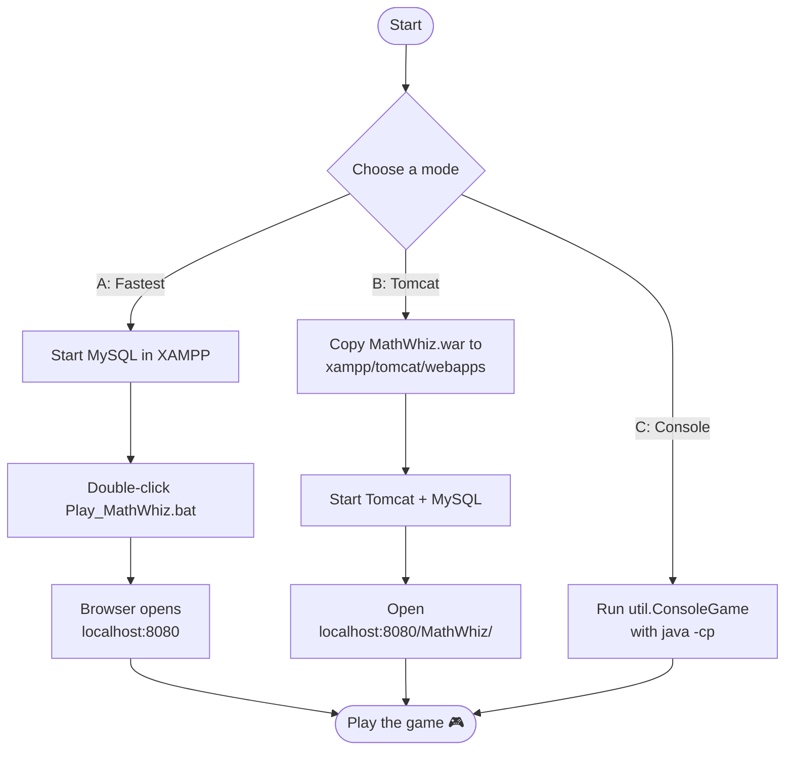

### Option A: 1-Click Instant Launch (Recommended)

1. Start **MySQL** in the **XAMPP Control Panel**.
2. Double-click `Play_MathWhiz.bat` in the project root.
3. Your browser opens automatically at `http://localhost:8080/`

---

### Option B: Deploying the WAR to Apache Tomcat (XAMPP)

1. Copy `target/MathWhiz.war` to your Tomcat webapps directory:
   `C:\xampp\tomcat\webapps\MathWhiz.war`
2. Start Tomcat in the XAMPP Control Panel.
3. Open the browser and visit: `http://localhost:8080/MathWhiz/`

---

### Option C: Interactive Command-Line Console Mode

```bash
java -cp "target\classes;target\MathWhiz\WEB-INF\lib\*" util.ConsoleGame
```

---

## 11. Testing

Testing is done at two levels: automated unit tests and a standalone console runner.

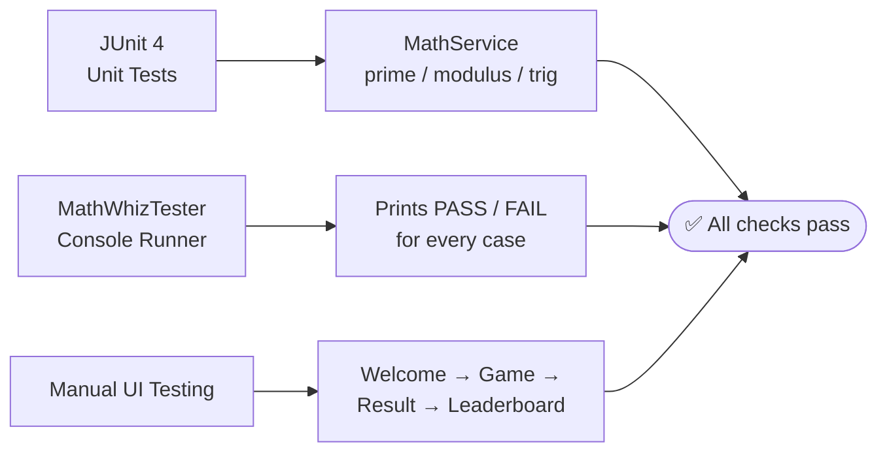

| Test Area | Cases Covered |
|---|---|
| Prime | prime, composite, `0`, `1`, negative numbers |
| Modulus | normal values, divisor `0` (exception handled) |
| Trigonometry | `sin`, `cos`, `tan` with the ±0.05 tolerance |
| Scoring | all correct (10), all wrong (0), mixed answers |
| Database | insert score, Top 10 ordering, tie-break by time |

---

## 12. Application Screenshots

### Welcome Page
*Screen 1: Player name input with Afsin auto-suggestion and a game rules overview.*


### Game Page
*Screen 2: Four mathematical challenges with user-entered numbers and answers.*


### Result Page
*Screen 3: Final score (out of 10), performance badge and detailed question breakdown.*


### Leaderboard
*Screen 4: Top 10 Hall of Fame ranked by highest score and completion time.*


---

## 13. Troubleshooting

| Problem | Likely Cause | Fix |
|---|---|---|
| Blank page / HTTP 404 | WAR not deployed or wrong URL | Check `webapps/MathWhiz.war` and open `/MathWhiz/` |
| `Communications link failure` | MySQL is not running | Start MySQL in the XAMPP Control Panel |
| `No suitable driver found` | JDBC jar missing | Confirm `mysql-connector-j-8.4.0.jar` is in `WEB-INF/lib` |
| `Access denied for user 'root'` | Different MySQL password | Update the credentials in `DBConnection.java` |
| `Unknown database 'math_whiz_db'` | SQL script not executed | Run `database/math_whiz_db.sql` |
| Port `8080` already in use | Another server is using it | Stop that service or change the Tomcat port |
| `ClassNotFoundException: javax.servlet...` on Tomcat 10 | Namespace changed to `jakarta` | Use Tomcat 9.0 or migrate imports |

---

## 14. Learning Outcomes & Future Improvements

### What This Project Demonstrates

- Servlet lifecycle and `doGet` / `doPost` request handling.
- Separation of concerns using Controller, Service, DAO and View layers.
- Safe database access with JDBC and `PreparedStatement`.
- Exception handling for invalid input (for example, division by zero).
- Writing verifiable code with JUnit and a console test runner.

### Possible Future Improvements

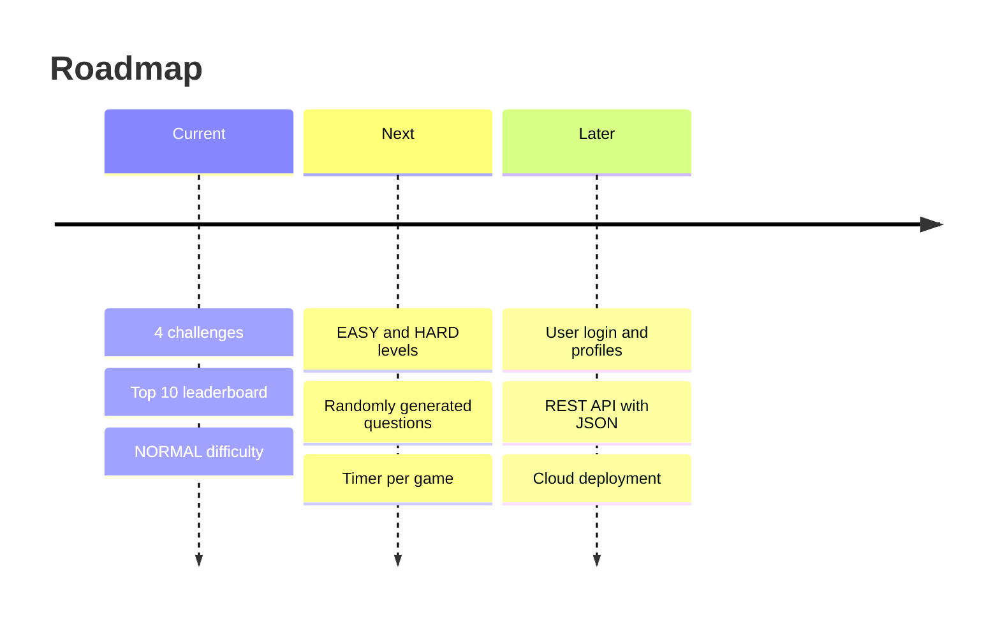

---

## 15. GitHub Submission Checklist

- [x] Complete Java source code (`GameServlet`, `GameScore`, `MathService`, `ScoreDAO`, `DBConnection`).
- [x] Servlet and JSP implementation with dynamic server-side processing.
- [x] JDBC database connectivity with `PreparedStatement`.
- [x] Database SQL script (`database/math_whiz_db.sql`).
- [x] Four-question mathematical game covering Prime, Modulus and Trigonometry.
- [x] Score calculation adhering to the 10-mark distribution.
- [x] Top 10 leaderboard sorted by `score DESC, played_at ASC`.
- [x] Complete README.md documentation with setup steps and diagrams.
- [x] Application screenshots (`screenshots/*.png`).
- [x] Ready for GitHub submission.

### GitHub Repository Link

```text
https://github.com/it24054-cyber/Afsin-Math-Whiz
```

---

<div align="center">

*Created by **Afsin** for Practical Lab Assignment: Java Web Application Development.*

⭐ If you like this project, give it a star on GitHub!

</div>
